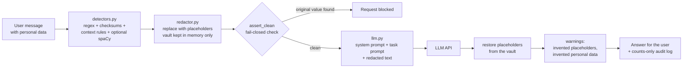

# Architecture

## Flow

Only the redacted text crosses the network. The vault (placeholder to real value) exists only in memory for one request.

## Modules

| Module | Job |
|---|---|
| `config.py` | Loads `config.yaml` (settings) and `.env` (API key) into typed Pydantic objects |
| `validators.py` | Verhoeff (Aadhaar), Luhn (cards), PAN holder-type check |
| `detectors.py` | One detector per data type; resolves overlaps by priority; links later mentions of a found name |
| `ner.py` | Optional spaCy person detection (loaded lazily, skipped if not installed) |
| `redactor.py` | `redact` / `restore` / `assert_clean` / `mask`; the same value always gets the same placeholder |
| `llm.py` | OpenAI-compatible client, prompt-file loading, task listing |
| `gateway.py` | Orchestrates the flow, builds warnings, writes the audit log |
| `main.py`, `cli.py`, `ui/app.py` | FastAPI service, command line and Streamlit demo, all calling `Gateway` |
| `evaluation/` | Synthetic dataset generator, metrics, ablation runner, round-trip check |

## Design decisions

1. **Detection is deterministic and local.** It does not use an LLM, because sending the data to a model to *find* the personal data would defeat the purpose. It is also free, fast and unit-testable.
2. **Checksums before patterns.** Many identifiers are just digit strings. The checksum is what separates an Aadhaar number from an order ID.
3. **Context beats shape.** `A/C no. <14 digits>` is an account number even if the digits happen to pass the Luhn card test, so context-labelled detections have the highest priority.
4. **Fail closed.** If the safety check finds an original value in the outgoing text, nothing is sent. The check matches whole tokens, so a phone number is not "found" inside a longer order number.
5. **Placeholders are consistent.** The same person or number maps to one placeholder (`[PERSON_1]` everywhere), so the model can still reason ("the customer asked twice").
6. **The prompt files are part of the design.** `system_prompt.txt` tells the model to copy placeholders exactly and never invent personal data; the gateway then checks that it obeyed.
7. **Audit log without data.** Only counts per type are written, so the log itself cannot leak personal data.
8. **Provider independence.** The gateway depends on a tiny `ChatClient` protocol; any OpenAI-compatible provider works through `base_url`.

## Bugs the evaluation found (good to mention)

* A 12-digit slice of a space-separated 16-digit card was matched as an Aadhaar number, leaving the card's last digits unredacted. Fixed with look-around guards; covered by a test.
* The leak check originally searched for raw substrings and wrongly blocked a request when a phone number appeared inside a longer order number. It is now token-aware.
* A name pattern crossed a line break and swallowed the next field. Names now match on one line only.

## Testing

* Unit tests for each validator, detector rule, redaction and restoration, including the look-alike decoys.
* Gateway tests with a fake LLM that records what it was sent, proving the original values never leave: the prompt contains only placeholders, fail-closed blocks a deliberate leak, and the audit log has counts only.
* API tests (status codes 200 / 413 / 422 / 502 / 503) and OpenAI-client tests against a faked HTTP layer.
* A regression test that fails if the headline claim (each idea improves the scores) stops being true.

## Threat model and limits

PrivGate reduces what the LLM provider receives; it does not make a system compliant by itself. Remaining risks: undetected personal data (especially bare names and addresses), re-identification from context, and the real values being shown in your own UI or logs. It is not legal advice.
